# F Soluções · Plataforma de Pedidos para Representantes

Sistema web **multiempresa (SaaS)** para **representantes comerciais, distribuidoras e fábricas**, desenvolvido por
**Fábio Leite Ferreira** em C# / ASP.NET Core.

O cliente recebe um **link exclusivo**, monta o pedido pelo celular e o pedido chega pronto no painel do representante,
com **estoque, comissão, entrega e financeiro** já calculados. Funciona como **aplicativo no celular** (PWA), e cada
representante tem a sua loja, com produtos e clientes separados dos demais.

> 🔒 **Este repositório é a vitrine do projeto.** O sistema está em uso comercial, por isso o código-fonte fica em um
> repositório privado. **Recrutadores e empresas podem pedir acesso ao código**: veja [Contato](#contato).
>
> Todos os prints e o vídeo foram feitos na **Loja Demonstração**, que usa apenas dados inventados.

---

## Vídeo (40 segundos)

[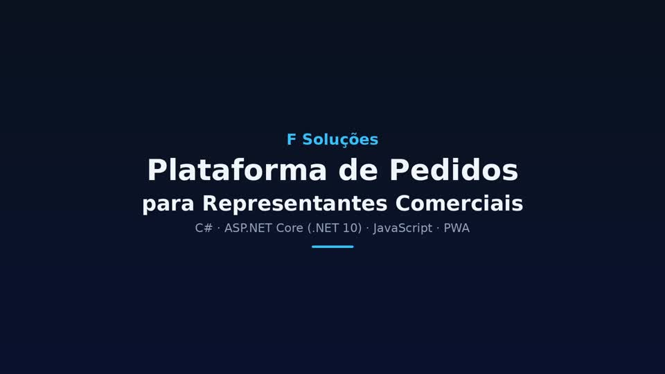](docs/F-Solucoes-Plataforma-de-Pedidos.mp4)

*Clique na imagem para abrir o vídeo.*

---

## Sumário

1. [Telas e funcionalidades](#telas-e-funcionalidades)
2. [Tudo o que o sistema faz](#tudo-o-que-o-sistema-faz)
3. [Tecnologias e arquitetura](#tecnologias-e-arquitetura)
4. [Segurança e dados](#segurança-e-dados)
5. [Qualidade e testes](#qualidade-e-testes)
6. [Próximos passos](#próximos-passos)
7. [Contato](#contato)

---

## Telas e funcionalidades

### 1. Entrada única para dono e representantes
Uma só tela de login para a loja. O sistema reconhece quem entrou: o **dono** vai para o painel completo e o
**representante** vai para a área dele. Há olho para mostrar a senha, aviso de e-mail digitado errado,
limite de 5 tentativas a cada 15 minutos e botão para **instalar como aplicativo**.

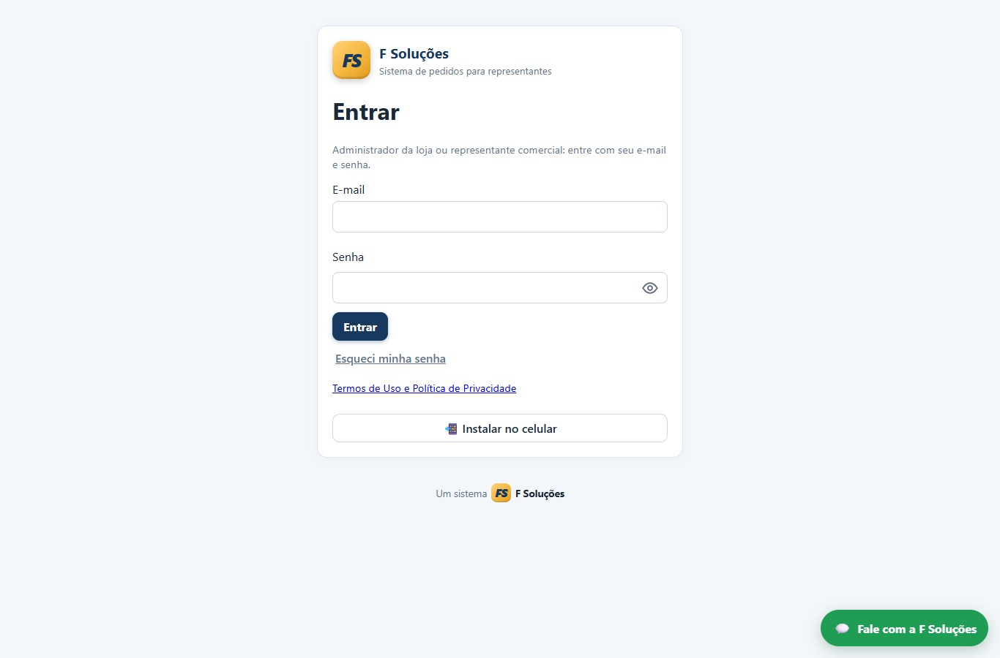

### 2. Painel do dono
Visão do negócio em uma tela: pedidos, **a receber**, **recebido** e **lucro bruto**, aviso de pedidos novos
aguardando conferência e menu organizado em **Vendas, Estoque, Financeiro e Loja e sistema**.

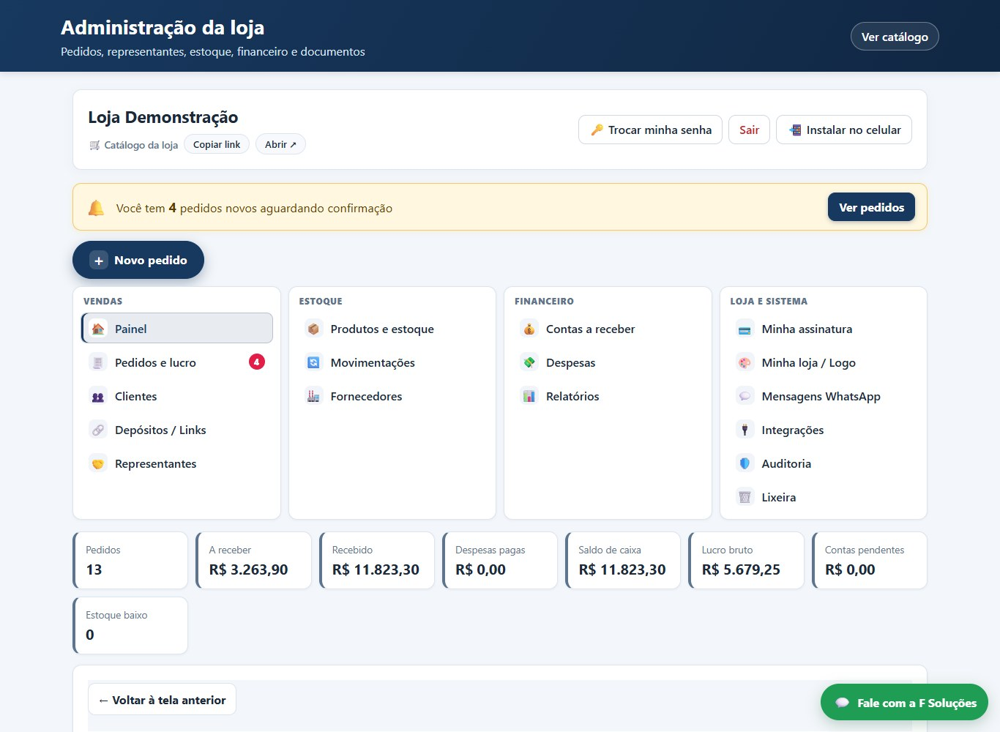

### 3. Novo pedido (pelo dono ou pelo representante)
Fluxo guiado: **cliente → produtos → quantidades → desconto → conferência → confirmar**. O servidor recalcula
preços, descontos e estoque. Clique duplo ou queda de internet **não duplicam** o pedido.

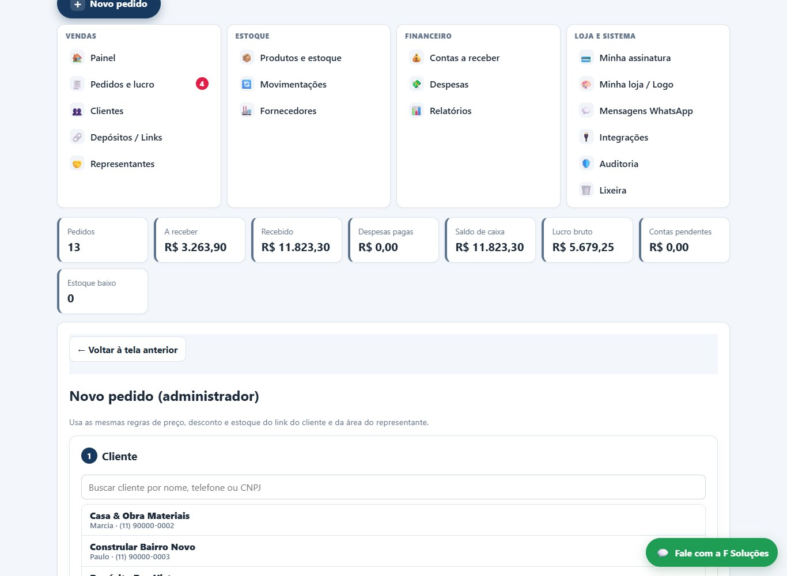

### 4. Pedidos e lucro
Lista de pedidos com origem (link do cliente, catálogo, representante ou administrador), situação, total, custo e
**lucro de cada pedido**. Dentro do pedido: histórico de status, pagamentos, entrega, etiqueta/romaneio e aviso ao
cliente pelo WhatsApp.

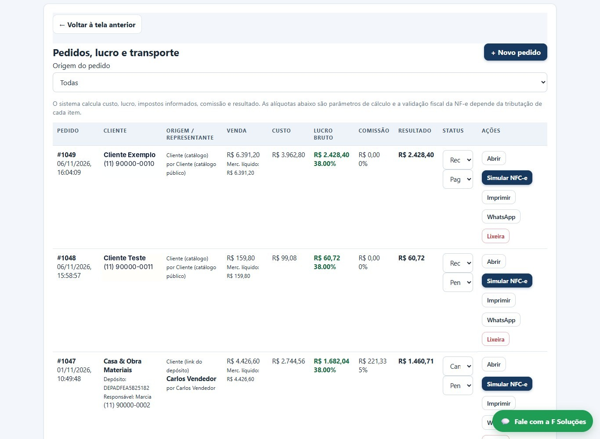

### 5. Depósitos / Links: um link de pedido para cada cliente
Cada cliente (depósito, loja) tem um **link exclusivo** para pedir sozinho, sem login. Daqui o dono copia o link,
envia pelo WhatsApp e escolhe **qual representante** atende aquele cliente.

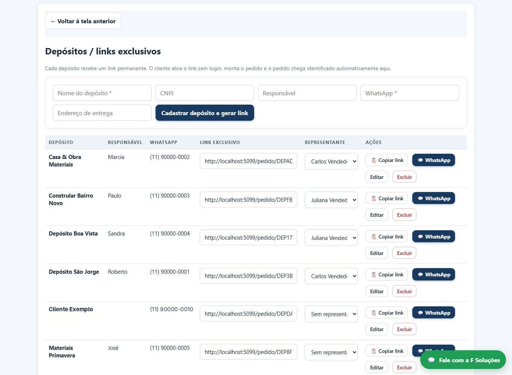

### 6. Representantes e comissão
Cadastro da equipe de vendas com **comissão (%)** e permissões: pode cadastrar clientes, vê todos ou só os seus,
pode dar desconto e **desconto máximo**. A comissão é calculada sozinha em cada pedido. O representante **nunca vê
o custo nem o financeiro** do dono, e isso é conferido no servidor em toda chamada.

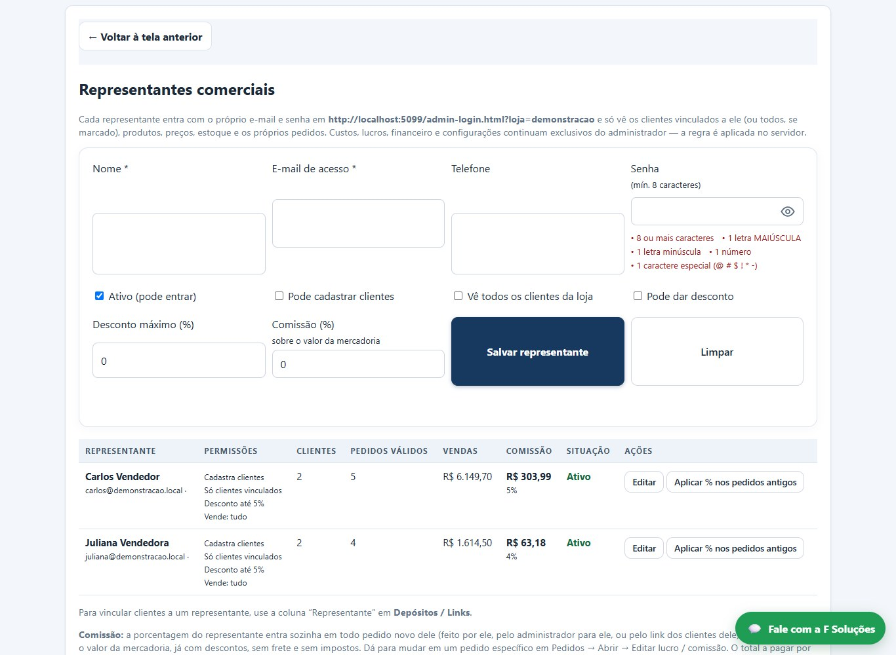

### 7. Produtos e estoque
Catálogo com fotos (trocar pela câmera do celular), código, preço, custo, **caixas/fardos**, variações,
**tabelas de preço por cliente**, estoque mínimo e "tirar de linha". Importação por **planilha (CSV/Excel)** e por
**XML de nota fiscal** do fornecedor. Toda entrada e saída fica registrada em **Movimentações**.

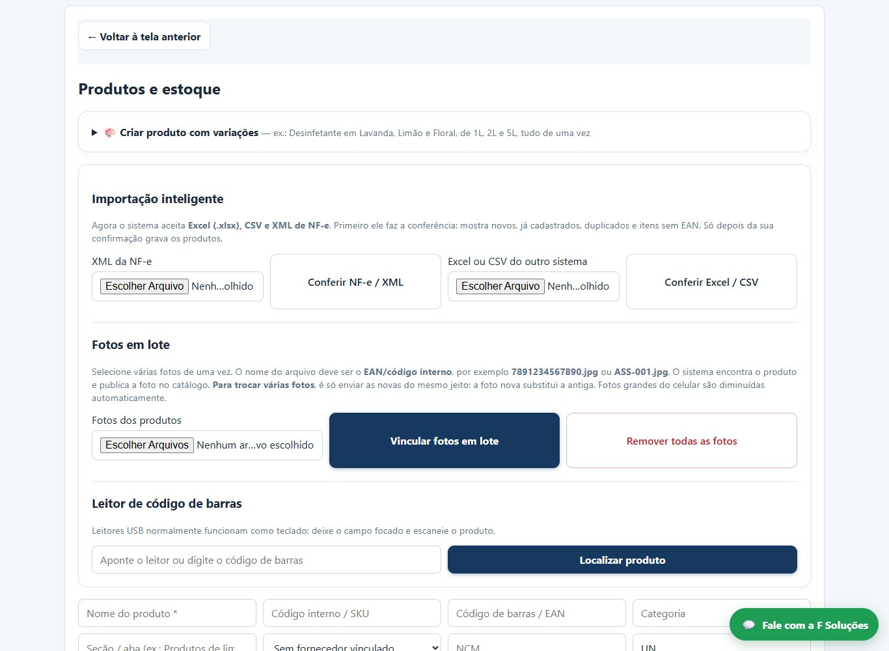

### 8. Contas a receber
Parcelas com vencimento, **pagamentos parciais**, estorno, recibo e quem está devendo. A soma das parcelas é
sempre exata (resíduo de centavos na última parcela).

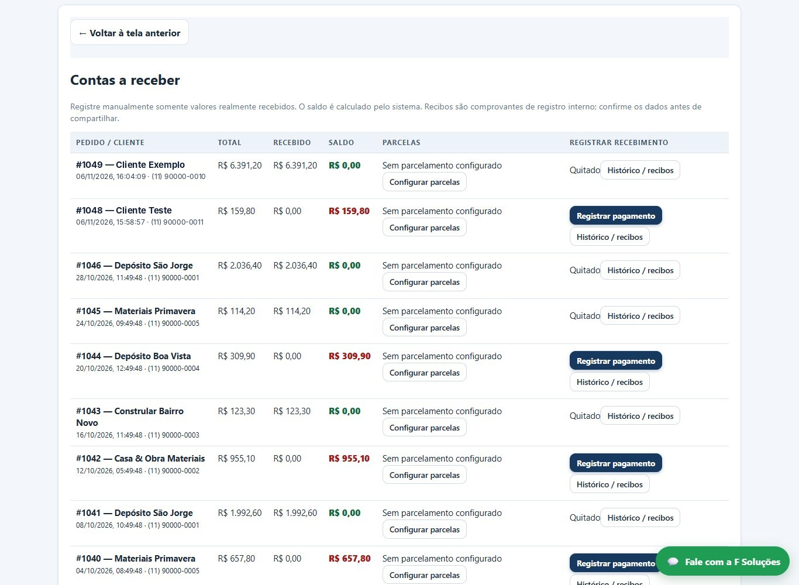

### 9. Relatórios
Vendas por **período, cliente, representante, origem e mês**, lucro e **comissão a pagar por representante**.
Pedidos cancelados ficam à parte.

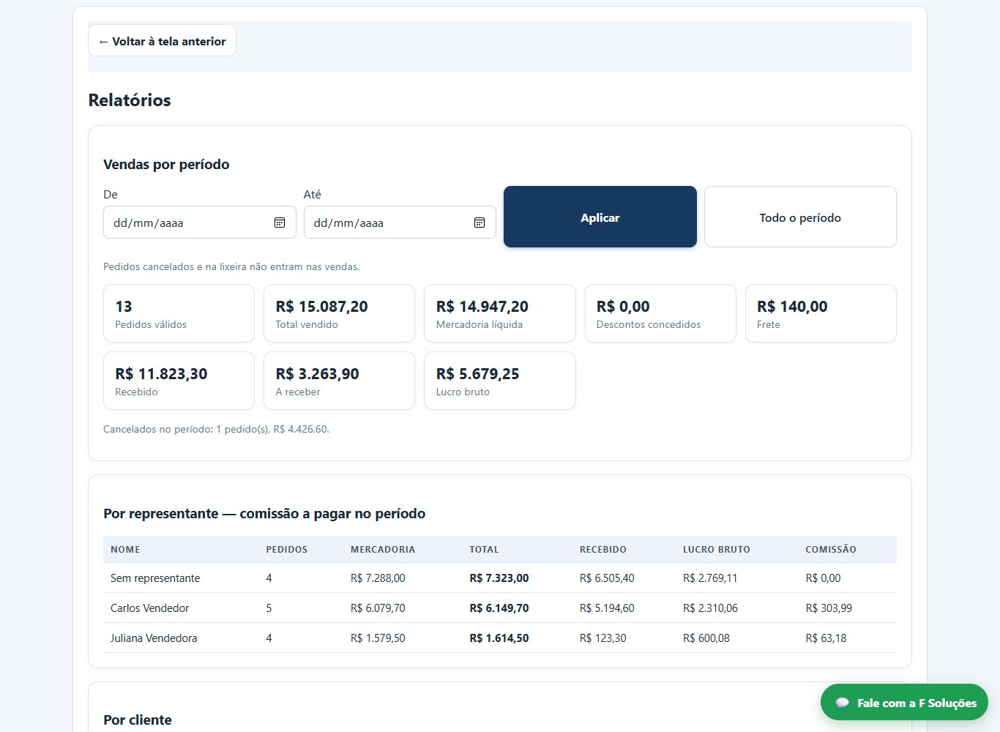

### 10. Catálogo no celular
Vitrine da loja para o cliente: busca, categorias, fotos, carrinho e envio do pedido. Instala como aplicativo,
com ícone na tela inicial.

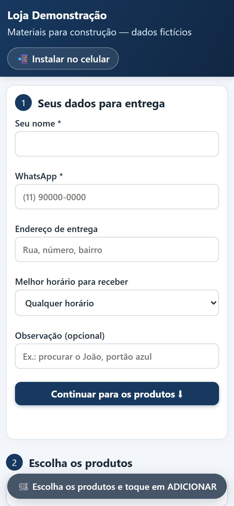

### 11. Pedido do depósito pelo link
O cliente abre o link que recebeu no WhatsApp, já com os **dados de entrega preenchidos**, escolhe os produtos e
envia. O pedido cai na hora no painel do representante. O preço enviado pelo navegador é ignorado: vale o do servidor.

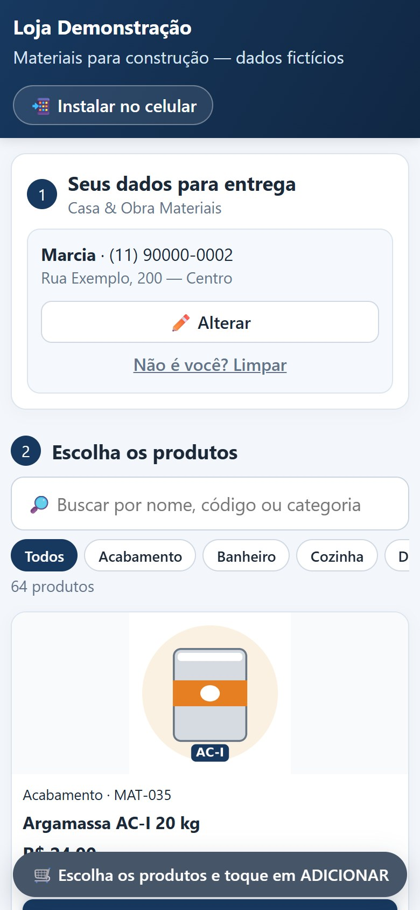

### 12. Painel no celular
O dono e os representantes usam o sistema inteiro pelo celular.

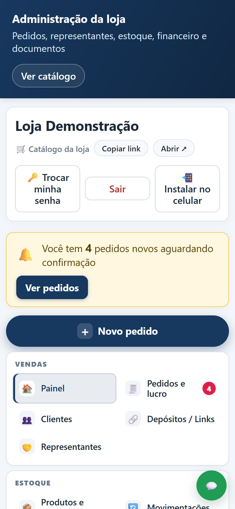

---

## Tudo o que o sistema faz

**Vendas**
- Link de pedido exclusivo por cliente (sem login) e catálogo público da loja
- Pedido pelo representante, pelo dono, pelo link ou pelo catálogo, todos com a mesma regra de cálculo
- Status do pedido com histórico (aguardando conferência, recebido, em separação, enviado, concluído, cancelado)
- Proteção contra pedido duplicado (clique duplo / queda de conexão)
- Aviso de pedido novo no painel

**Representantes**
- Área própria (`rep.html`): painel, novo pedido, meus pedidos, clientes e produtos sem custo
- Comissão automática e relatório de comissão a pagar
- Permissões por representante; representante desativado perde o acesso na hora

**Estoque e produtos**
- Baixa ao confirmar, devolução ao cancelar, sem baixar ou devolver duas vezes
- Pedidos simultâneos não vendem o mesmo saldo (gravação com trava única)
- Caixas, fardos, variações e tabela de preço por cliente
- Fotos com redução automática, troca pelo celular e lixeira de fotos
- Importação por planilha e por XML de NF-e; fornecedores e movimentações

**Financeiro**
- Contas a receber com parcelas, pagamento parcial, estorno e recibo
- Despesas, lucro bruto por pedido (custo congelado no momento da venda)
- Simulação de NFC-e e registros internos de nota (sem validade fiscal)

**Entrega**
- Modalidades (retirada, entrega própria, transportadora CIF/FOB, Correios), transportadora, rastreio e previsão
- Etiqueta por volume e romaneio com assinatura de recebimento
- Mensagem pronta para avisar o cliente no WhatsApp

**Plataforma (SaaS, multiempresa)**
- Painel do dono da plataforma (`platform.html`): lojas cadastradas, teste grátis, bloqueio, "recebi pagamento (+1 mês)"
- **Convite por link** com teste grátis: o representante cria a própria conta sozinho
- Cobrança da mensalidade por **Pix (copia e cola)** ou link de cartão
- Loja de demonstração com dados inventados, criada com um clique
- Auditoria, lixeira, termos de uso e aceite (LGPD)

---

## Tecnologias e arquitetura

- **Back-end:** C# / ASP.NET Core Minimal APIs (.NET 10), autenticação por cookie, `PasswordHasher` para senhas
- **Front-end:** HTML, CSS e JavaScript puro (sem framework), PWA com *service worker* e manifesto
- **Dados:** armazenamento em JSON com gravação protegida por trava e cópias de segurança (migração para MySQL em andamento)
- **Testes:** xUnit + `WebApplicationFactory` (cálculos e integração)

```
API e regras de negócio   ASP.NET Core Minimal APIs (rotas por perfil: plataforma, dono da loja, representante, público)
Cálculos                  módulo próprio com decimal e centavos: descontos, impostos, frete e parcelas
Telas                     admin, representante, catálogo, link de pedido e painel da plataforma
Testes                    testes automatizados de cálculo, permissão, concorrência e integração
```

---

## Segurança e dados

- Cada empresa só acessa os próprios dados; permissões conferidas no servidor em toda rota
- Senhas com hash, limite de tentativas de login, troca de senha exigindo a senha atual
- Upload de imagem confere o conteúdo do arquivo; proteção contra XSS nos campos exibidos
- Dados reais de clientes ficam fora do controle de versão; os prints e o vídeo usam só a **Loja Demonstração**

---

---

## Qualidade e testes

Os testes automatizados sobem o sistema com uma pasta de dados temporária e vazia e cobrem **cálculos, permissões,
concorrência de estoque, pedidos duplicados, financeiro, notas, convites, Pix e loja de demonstração**.

---

## Próximos passos

- Migrar o armazenamento para **MySQL**
- Hospedar na **AWS (Lightsail, Linux)** com domínio próprio e HTTPS
- Emissão fiscal real (NFC-e/NF-e) e envio automático de WhatsApp

---

## Contato

**Fábio Leite Ferreira** · Desenvolvedor C# / .NET

**F Soluções** · Sistemas, aplicativos e sites sob medida · WhatsApp (11) 93937-3261

Quer ver o código-fonte? Me chame pelo WhatsApp que eu libero o acesso ao repositório privado.

Outros projetos: [github.com/fabioleiteferreira](https://github.com/fabioleiteferreira)
